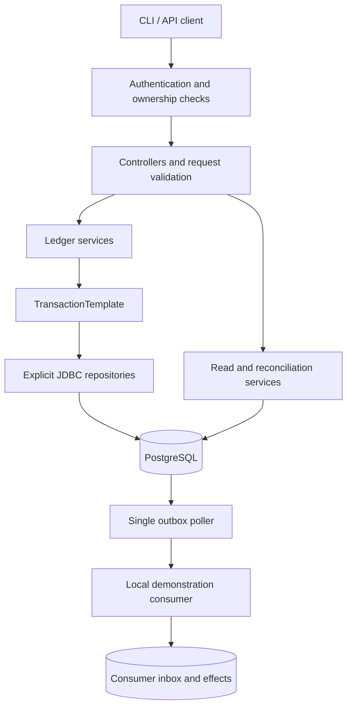

# LedgerCore — Technical Design

**Revision:** 1.2 — 31 October 2026.  
**Status:** specification. Implemented in this repository (4 November 2026); the repository README records the test evidence, measurements and limitations. This document remains the contract that implementation follows.  
**Audience:** a fresher building a defensible backend engineering portfolio.  
**First release:** one Java application, one PostgreSQL database, one currency, and a local event-consumer demonstration.

## 1. Product and use case

LedgerCore records movements of a simulated customer cash balance. A backend developer integrates its API into a small wallet or investment-account demonstration. The developer needs transfers to survive retries, concurrent spending attempts to respect available funds, and a journal explaining every balance change.

The primary demonstration is a transfer that commits successfully but loses its HTTP response. Retrying the same request must return the recorded result without moving money again. Other demonstrations cover competing payments, reservation capture, reversal, and delayed event delivery.

This is an educational ledger service. It does not connect to banks, settle real payments, calculate investment returns, implement regulatory controls, or represent a complete general ledger. All example balances are synthetic.

## 2. Scope and stack

Use Java 21, a compatible supported Spring Boot release, Spring Web, Spring Security, Spring JDBC, PostgreSQL, versioned database migrations, JUnit, and PostgreSQL integration tests through Testcontainers. Pin exact compatible dependency versions when implementation begins; do not use floating versions.

Choose `JdbcTemplate` for explicit SQL and `TransactionTemplate` for visible transaction boundaries. A student should be able to read a service method and see the locking, validation, updates, journal insertion, and commit boundary. Spring handles connection management and transaction integration. See [Spring JDBC connections](https://docs.spring.io/spring-framework/reference/data-access/jdbc/connections.html) and [programmatic transactions](https://docs.spring.io/spring-framework/reference/data-access/transaction/programmatic.html).

Include account creation, synthetic funding, transfers, full holds, full capture, release, full reversal, journal queries, reconciliation checks, and an outbox. Exclude partial capture, expiration, foreign exchange, interest, fees, overdrafts, distributed transactions, Kafka, custom storage, and microservices.

## 3. Component architecture



Controllers translate HTTP contracts. Services own business rules and transaction ordering. Repositories execute named SQL operations; they do not decide whether a payment is allowed. The outbox poller runs independently of payment requests, but initially within the same application process. The local consumer has separate persisted inbox state and exposes a simple test endpoint.

One financial mutation commits its journal, balance projection, idempotency result, audit event, and outbox event together. No external HTTP call occurs while account locks are held.

PostgreSQL supplies transaction atomicity, locking, write-ahead logging, and crash recovery. LedgerCore supplies accounting rules and the application protocol. The design does not promise availability through database failure or durability beyond the configured database and storage guarantees.

## 4. Money and accounting model

Configure one currency: INR, with two decimal places. Store all amounts as signed 64-bit integer minor units; `12500` represents ₹125.00. Accept positive transfer amounts only. Use checked addition/subtraction and reject overflow before writing. Never use floating-point arithmetic. Encode API money values as decimal integer strings to avoid browser integer-precision problems.

Customer accounts represent credit-normal liabilities in this simplified ledger. A CREDIT posting increases the customer's recorded cash; a DEBIT decreases it. Define the stored `credit_balance_minor` as credits minus debits for every account. A special system funding-control account may therefore have a negative balance. Only customer accounts must remain nonnegative.

Every posted journal contains exactly two equal-amount entries to different accounts: one DEBIT and one CREDIT. Thus total debits equal total credits. Funding a customer debits the system control account and credits the customer; it never changes a balance without journal entries. Transfers debit the source and credit the destination.

For a customer:

`available_minor = credit_balance_minor - reserved_minor`

`reserved_minor` is the sum of active hold amounts. A hold reserves spendable capacity and does not move money, so creation and release produce audit events but no journal postings.

Example: a customer starts with 10,000 minor units. A hold for 3,000 leaves posted balance 10,000, reserved 3,000, and available 7,000. Capturing it transfers 3,000 to the designated recipient: posted balance becomes 7,000 and reserved becomes zero. Releasing it instead restores availability to 10,000 without changing posted balance.

Balances are a projection maintained in the same transaction as postings. The journal is the historical source used to reconcile that projection. Reservations require a separate reconciliation against active holds.

Run the following reconciliation checks in one read-only REPEATABLE READ transaction, so all checks refer to the same committed snapshot:

- Every journal has exactly two distinct-account postings, one debit and one credit, both equal to the journal amount.
- For each account, reconstruct credits minus debits from all its postings and compare that value with `credit_balance_minor`; include accounts with no postings as zero.
- Sum `credit_balance_minor` across **all accounts, including SYSTEM_CONTROL**; the total must be zero because every account starts at zero and each journal balances. Summing customer accounts alone is not this invariant.
- For each customer, sum its ACTIVE holds and compare with `reserved_minor`; also verify that available funds remain nonnegative.
- Verify the singleton control account has no reservations and that each captured hold links to the matching capture journal.

Use a wide aggregate type for reconciliation totals. A zero global sum alone cannot prove each individual balance is correct; retain the per-account reconstruction checks. Report discrepancies without automatically rewriting historical entries or projections.

## 5. Operation semantics

| Operation | Required behavior |
|---|---|
| Create account | Create an ACTIVE customer account with zero balances and an immutable owner. |
| Synthetic funding | ADMIN-only debit of system control and credit of a customer; visibly labelled demo funding. |
| Transfer | Source and destination differ; both are ACTIVE customers; source available balance covers amount. |
| Create hold | Source and destination are fixed at creation; reserve full amount from source availability. |
| Capture hold | ACTIVE hold becomes CAPTURED once; transfer the entire reservation to its destination and release the reservation atomically. |
| Release hold | ACTIVE hold becomes RELEASED once; subtract its reservation; no postings. |
| Reverse | ADMIN-only full compensating transfer for an original transfer or capture; original entries remain unchanged. |

Holds have no automatic expiry in version one. Capture and release race under the same locks; exactly one terminal transition may succeed. A repeated action with the original idempotency key returns the original result. A new key against a terminal hold returns a state-conflict response.

The schema reserves CLOSED for a later account lifecycle. Version one creates ACTIVE accounts and exposes no close, reopen, owner-change, or account-deletion endpoint.

A reversal swaps the original posting directions. It requires sufficient available funds in the original recipient account, protecting that account's own holds. A unique original-reference prevents a second reversal. Funding and reversal journals cannot themselves be reversed in version one. Reversing a capture does not reactivate the old hold.

## 6. Proposed database schema

All primary identifiers are UUIDs, all timestamps are UTC `timestamptz`, and fields are NOT NULL unless marked optional. Money fields use `bigint`. Application-generated UUIDs are identifiers, not ordering guarantees.

| Table | Essential fields and constraints |
|---|---|
| `principals` | `id` PK; `external_subject` UNIQUE; `role` constrained to CUSTOMER or ADMIN; `created_at`. Authentication credentials stay outside ledger tables. |
| `accounts` | `id` PK; optional `owner_id` FK principals; `kind` CUSTOMER or SYSTEM_CONTROL; `currency` constrained to INR; `state` ACTIVE or CLOSED; `credit_balance_minor`; `reserved_minor`; `created_at`. Customer checks: owner present, balance ≥ 0, reserved ≥ 0 and ≤ balance. System checks: owner absent, reserved = 0. |
| `journals` | `id` PK; `kind` FUNDING, TRANSFER, CAPTURE, REVERSAL; `amount_minor > 0`; `actor_id` FK; optional `reverses_id` FK journals with UNIQUE; `created_at`. A reversal must have its reference; other kinds must not. |
| `postings` | `journal_id` FK journals; `line_no` constrained to 1 or 2; `account_id` FK accounts; `side` DEBIT or CREDIT; `amount_minor > 0`. PK `(journal_id, line_no)`; UNIQUE `(journal_id, side)` and `(journal_id, account_id)`. |
| `holds` | `id` PK; `source_id`, `destination_id` FKs accounts; `amount_minor > 0`; `state` ACTIVE, CAPTURED, RELEASED; optional `capture_journal_id` UNIQUE FK; `created_at`; optional `closed_at`. Distinct accounts; CAPTURED requires journal and closed time; RELEASED requires closed time and no journal; ACTIVE requires neither. |
| `idempotency_requests` | `principal_id` FK; `operation_scope`; `key`; `request_hash`; state IN_PROGRESS or COMPLETE; optional `http_status`, `response_json`, `resource_id`; `created_at`. Composite PK `(principal_id, operation_scope, key)`. COMPLETE requires recorded status and response. |
| `audit_events` | `id` PK; `actor_id` FK; `action`; `resource_type`; `resource_id`; `request_id`; `details_json`; `created_at`. Append-only through the application role. |
| `outbox_events` | `id` PK; `audit_event_id` UNIQUE FK; `type`; `schema_version`; `payload_json`; `state` PENDING, PUBLISHED, or FAILED; `created_at`; `attempts ≥ 0` since latest manual retry; `total_attempts ≥ attempts`; `next_attempt_at`; optional `published_at`, `last_error_code`. PUBLISHED requires a publication timestamp; other states require none. |
| Consumer `inbox` | `event_id` PK; `received_at`; `payload_hash`; consumer effect persisted in the same transaction. |

Create indexes on postings by account and journal, holds by source/state, pending outbox delivery time, and journal listing order. Index foreign-key columns used for joins; PostgreSQL does not automatically create every referencing-side index.

Bootstrap creates exactly one zero-balance ACTIVE SYSTEM_CONTROL account with a fixed migration-owned UUID. A partial unique index on `kind` restricted to SYSTEM_CONTROL permits at most one; bootstrap plus readiness validation ensures one actually exists. Only the migration role can create this account kind. Customer creation cannot choose it. Missing or duplicate control configuration makes readiness fail.

Row checks cannot enforce the entire accounting system. Exactly two postings, equal amounts, journal/posting agreement, compatible account kinds, journal/projection agreement, and reserved/active-hold agreement are service-transaction invariants, reinforced by reconciliation tests. A CHECK is not a safe cross-row aggregate constraint. [PostgreSQL constraint documentation](https://www.postgresql.org/docs/current/ddl-constraints.html)

Use separate migration and application database roles. The application can insert/read journals and postings but cannot update/delete them. Account identifiers, ownership, hold participants, and amounts remain immutable through application APIs. A database administrator can still modify data; this audit design is not tamper-proof.

## 7. Transaction and lock protocol

Authenticate and load the principal's current database role on every request, including an idempotent replay. Before claiming an idempotency key or taking account locks, check the endpoint permission and immutable resource ownership with ordinary reads. For example, reject a transfer unless its source belongs to the caller; for a hold action, read its fixed participants and authorize the source owner or ADMIN. This prevents a forbidden request from obtaining account locks. Return the same 404 response for an absent resource and a resource the caller cannot inspect; use 403 for a denied role-level operation.

Use READ COMMITTED for mutations with explicit row locks. After the early permission check, enter the transaction, reload the principal role for privileged decisions, and acquire the idempotency claim. If current authorization no longer permits the request, reject it before the claim; do not return a stored success to an unauthorized caller. Then acquire all affected account rows one-by-one in the canonical UUID order defined below. For hold actions, lock those accounts, then lock and reread the hold. For reversals, read immutable original postings, lock their accounts, then check for an existing reversal using a new query. The account locks serialize competing reversals; the unique original-reference is additional protection. Do not request an update lock on immutable journal rows. Every service follows this order.

Define one shared account-lock helper: parse identifiers as UUID values, remove duplicates, convert each to its canonical lowercase `UUID.toString()` form, and sort using Java's ordinary lexicographic `String.compareTo`. Lock each account individually in that order. Funding, transfers, hold creation/capture/release, and reversals all use this helper. Never sort raw request strings or substitute `UUID.compareTo` on one path. JDK 21's natural UUID comparison uses signed 64-bit halves and can disagree with this order. Test identifiers on both sides of the first-hex-digit `8` boundary, equal first halves with differing second halves, and opposite-direction operations on the same account pair. [JDK 21 UUID source](https://raw.githubusercontent.com/openjdk/jdk21u/master/src/java.base/share/classes/java/util/UUID.java)

Canonical string order agrees with PostgreSQL's bytewise UUID ordering, but version one still uses individual lock queries through the shared helper rather than a separate bulk `ORDER BY id FOR UPDATE` path. This is a simplifying code rule, not a claim that SQL UUID ordering is wrong. Ordinary reporting queries may use `ORDER BY id`. [PostgreSQL UUID comparator](https://raw.githubusercontent.com/postgres/postgres/master/src/backend/utils/adt/uuid.c)

Account locks protect both posted balance and reservations. Recheck ownership defensively against the locked row and validate every mutable condition there: account state, available funds, hold state, reservation amount, and reversal eligibility. An early ownership read does **not** authorize moving balance or state checks before the locks. The hold's state is checked only after its own lock is acquired. Ownership is immutable in this release, so the early check has no supported owner-change race. Role changes take effect when read by a new request; the design does not promise instantaneous cancellation of already-authorized in-flight work. Deterministic ordering reduces deadlock risk; it is not a promise that deadlocks are impossible. Configure bounded lock and transaction timeouts. [PostgreSQL row locks and deadlocks](https://www.postgresql.org/docs/current/explicit-locking.html)

Transfer flow: authenticate and parse; load current role and authorize immutable source ownership; start transaction; recheck the current role; claim key; lock accounts; confirm ownership and validate states, amount, and availability using locked values; insert journal and postings; update both projections; insert audit and outbox; complete the idempotency record; commit; then respond. A defensive authorization failure after claiming rolls back the claim and all business work.

The source owner may initiate transfers or create holds. Only that owner or ADMIN may capture/release its holds. A recipient does not gain access to the sender's journal details merely by knowing an identifier. ADMIN synthetic funding and reversal use explicit privileged endpoints and audited reasons.

Single-query balance reads use a committed snapshot. Multi-query reconciliation uses a read-only REPEATABLE READ transaction so its journal and balance checks share one snapshot. Reports from separate READ COMMITTED queries may otherwise observe different committed moments. [PostgreSQL isolation levels](https://www.postgresql.org/docs/current/transaction-iso.html)

## 8. Idempotency and retries

Require an `Idempotency-Key` on every mutation. Scope it to authenticated principal and operation, including target resource for capture/release/reversal. Hash a canonical representation of validated semantic fields: amount, currency, account identifiers, operation, and target. Exclude trace IDs and transport timestamps.

Within the business transaction, attempt an IN_PROGRESS insertion using conflict-do-nothing. Concurrent requests for the same key wait on the unique constraint. If insertion loses, issue a **new SELECT statement**: a matching hash returns the stored status/body; a different hash returns 409. The new statement is necessary because a conflicting insert can become committed after the first statement's snapshot. Do not combine the losing insertion and lookup into one statement and assume the winner is visible. If the competing transaction rolled back, the claimant can insert and execute. Respect lock timeout rather than waiting indefinitely.

This is one reason for the mutation protocol's READ COMMITTED choice. REPEATABLE READ retains a transaction snapshot and some concurrent update/conflict cases can instead abort with a serialization failure; it does not mean every transaction at that level fails. Supporting that isolation choice would require an explicitly tested whole-transaction retry protocol. [PostgreSQL isolation behavior](https://www.postgresql.org/docs/current/transaction-iso.html)

IN_PROGRESS exists only inside an uncommitted transaction. Every normal completion path must convert it to COMPLETE; unexpected exceptions roll back everything. There is no independently committed pending request requiring a recovery worker. An unexpected committed pending row is an invariant failure, not permission to rerun a payment.

Cache deterministic business failures, such as insufficient funds, as completed responses when no financial state has been changed. Such a request remains failed when retried with its key; a deliberate new attempt needs a new key. Malformed, unauthenticated, and unauthorized requests are rejected before claiming. Database errors and timeouts roll back and are not cached. Same-key waiters occupy database connections; measure pool wait time and test unrelated requests during a duplicate-key burst instead of assuming retries are free.

A response is sent only after commit. If commit outcome is unknown because the connection failed, return a retryable error and instruct the client to reuse the same key. Never invent a fresh key during retry. Keep records for the entire demo lifetime; retention and key reuse are later product decisions.

## 9. HTTP contract

These are proposed contracts, not executable examples. Requests and responses use JSON; all mutations return a resource reference and `requestId`.

| Endpoint | Input or result |
|---|---|
| `POST /v1/accounts` | ADMIN: owner identifier; returns account with zero balances. |
| `POST /v1/demo-funding` | ADMIN: destination, `amountMinor`, reason; returns journal. |
| `POST /v1/transfers` | `sourceAccountId`, `destinationAccountId`, `amountMinor`, `currency`; returns journal. |
| `POST /v1/holds` | Same money/participant fields; returns ACTIVE hold. |
| `POST /v1/holds/{id}/capture` | Empty semantic body; full amount only; returns capture journal. |
| `POST /v1/holds/{id}/release` | Empty semantic body; returns RELEASED hold. |
| `POST /v1/journals/{id}/reversal` | ADMIN: reason; returns compensating journal. |
| `GET /v1/accounts/{id}` | Owner or ADMIN: account identity, owner, currency, state, and creation time. |
| `GET /v1/accounts/{id}/balance` | Posted, reserved, available, currency, and observation timestamp. |
| `GET /v1/accounts/{id}/journals` | Bounded cursor pagination; caller sees authorized account entries. |
| `GET /v1/holds/{id}` | Source owner or ADMIN: participants, amount, state, and optional capture journal. |
| `GET /v1/admin/outbox?state=FAILED` | ADMIN: bounded page of failed event metadata. |
| `POST /v1/admin/outbox/{id}/retry` | ADMIN: reason and idempotency key; requeue a FAILED event. |

An illustrative transfer uses `POST /v1/transfers`, authenticated as the source owner with HTTP Basic credentials supplied by the client, with `Content-Type: application/json` and `Idempotency-Key: demo-transfer-001`. Credentials are omitted from the example. Its request body is:

```json
{
  "sourceAccountId": "11111111-1111-4111-8111-111111111111",
  "destinationAccountId": "22222222-2222-4222-8222-222222222222",
  "amountMinor": "12500",
  "currency": "INR"
}
```

An illustrative 201 response is:

```json
{
  "journalId": "33333333-3333-4333-8333-333333333333",
  "kind": "TRANSFER",
  "amountMinor": "12500",
  "currency": "INR",
  "createdAt": "2026-10-31T12:00:00Z",
  "requestId": "44444444-4444-4444-8444-444444444444"
}
```

An illustrative 422 response is:

```json
{
  "code": "INSUFFICIENT_AVAILABLE_FUNDS",
  "message": "Available funds do not cover this transfer.",
  "requestId": "55555555-5555-4555-8555-555555555555"
}
```

`GET /v1/accounts/{id}` returns 200 for the owner or ADMIN. Its metadata response is:

```json
{
  "accountId": "11111111-1111-4111-8111-111111111111",
  "ownerId": "66666666-6666-4666-8666-666666666666",
  "kind": "CUSTOMER",
  "currency": "INR",
  "state": "ACTIVE",
  "createdAt": "2026-10-31T10:00:00Z",
  "requestId": "77777777-7777-4777-8777-777777777777"
}
```

`GET /v1/accounts/{id}/balance` uses the same authorization and returns a balance read from one database statement:

```json
{
  "accountId": "11111111-1111-4111-8111-111111111111",
  "currency": "INR",
  "postedMinor": "50000",
  "reservedMinor": "10000",
  "availableMinor": "40000",
  "observedAt": "2026-10-31T12:10:00Z",
  "requestId": "88888888-8888-4888-8888-888888888888"
}
```

`GET /v1/holds/{id}` permits the source owner or ADMIN and returns 200 with this shape:

```json
{
  "holdId": "99999999-9999-4999-8999-999999999999",
  "sourceAccountId": "11111111-1111-4111-8111-111111111111",
  "destinationAccountId": "22222222-2222-4222-8222-222222222222",
  "amountMinor": "10000",
  "currency": "INR",
  "state": "ACTIVE",
  "captureJournalId": null,
  "createdAt": "2026-10-31T12:05:00Z",
  "closedAt": null,
  "requestId": "aaaaaaaa-aaaa-4aaa-8aaa-aaaaaaaaaaaa"
}
```

For a CAPTURED hold, both `captureJournalId` and `closedAt` are present values; for RELEASED, only `closedAt` is a value. Inaccessible and missing account/hold resources both return 404 with `code: RESOURCE_NOT_FOUND`, a safe message, and `requestId`. The recipient alone cannot query the sender's hold. ADMIN may inspect SYSTEM_CONTROL, whose `ownerId` is null and posted balance may be negative.

All monetary response fields are decimal integer strings. Reject decimals, signs where positive amounts are required, leading ambiguity, excess digits, and currency mismatch. These JSON examples specify contracts only.

Use 201 for creation, 200 for release and reads, 400 for malformed inputs, 401 for missing authentication, 403 for forbidden operations, 404 for inaccessible/missing resources under a consistent disclosure policy, 409 for key/state conflicts, 422 for insufficient funds or unsupported money values, and 503 for transient infrastructure failure. Errors contain a stable code, safe message, and request ID; they never expose SQL or credentials. Replays return the original status and body, optionally with an idempotent-replay header.

Cursor ordering uses `(created_at, id)` as a stable display order, not a global commit order. Strong historical exports require a separately defined snapshot contract; ordinary live pagination does not guarantee inclusion of every concurrent write.

## 10. Outbox delivery

Successful business mutations append one versioned PENDING event with a stable event ID. A single poller selects only events satisfying all three conditions: `state = PENDING`, `next_attempt_at <= now`, and `attempts < configured_limit`. It sends outside a database transaction and records PUBLISHED only after acknowledgment. Record completed delivery attempts in a short transaction and increment both counters on success or failure; an interrupted in-flight attempt can be retried without a recorded count. On failure, store an error category. Below the limit, schedule bounded exponential backoff; at the limit, set FAILED. FAILED events never enter the automatic polling query. A paginated ADMIN view and an exhausted-event metric make them visible; an alert or operator action is still required to resume delivery.

The ADMIN retry endpoint accepts only FAILED events, requires a reason, resets the current attempt counter to zero, preserves the total counter and event ID, clears the error category, sets PENDING with an immediate retry time, and appends an audit record. It does not recreate the original business operation or produce a fresh business event. A repeated manual command uses the normal idempotency protocol. Never silently delete exhausted events.

The consumer atomically inserts the event ID into its inbox and applies its demonstration effect. Duplicate IDs with identical payloads acknowledge successfully without repeating the effect; mismatched payload hashes are an error. A crash after consumer commit but before acknowledgment therefore causes a harmless duplicate.

The committed outbox removes the business-commit/event-creation dual-write gap within the database's durability guarantees. It does not guarantee delivery despite permanent destination failure, exhausted retries, data loss, or operator deletion. Delivery is at least once while retries and the destination remain available, with eventual delivery conditional on recovery and continued retries. There is no global exactly-once claim or ordering guarantee. Balance consumers should fetch current state instead of assuming arrival order. Multiple publishers and leased claims are deferred; start with one configured poller instance.

## 11. Failure handling and verification

| Failure or race | Required result |
|---|---|
| Crash before database commit | No journal, balance change, completed key, or event survives. |
| Crash after commit before HTTP reply | Same-key retry returns the committed result. |
| Two spends exceed availability together | At most the affordable subset succeeds; no negative customer availability. |
| Capture races release | One terminal transition and consistent reservations. |
| Different payload reuses key | 409; no extra mutation. |
| Consumer fails | Ledger remains committed; event stays retryable/visible. |
| Consumer acknowledgment is lost | Inbox deduplication prevents repeated effect. |
| Database unavailable or deadlock victim | Transaction aborts; bounded retry policy preserves the original key. |

Integration tests must use real PostgreSQL behavior. Unit-test money parsing, overflow, state transitions, and canonical hashing. Integration-test rollback at injected failure points, concurrent duplicate keys, reversed lock-order workloads, insufficient funds, reversal uniqueness, and projection reconciliation. Verify balanced journal pairs, each account's reconstructed balance, the global zero sum including SYSTEM_CONTROL, and reservations after concurrent tests. Check that forbidden requests never reach account-lock acquisition, that a stored idempotent result cannot bypass current authorization, and that unrelated work remains bounded during same-key connection-pool pressure. Test the retry limit, visible FAILED events, manual retry idempotency, and preservation of event identity and total attempts.

The acceptance demonstration should show 100 concurrent submissions of one transfer key yielding one journal; competing transfers from a deliberately small balance; capture/release contention; response-loss recovery; and consumer restart after lost acknowledgment. Record actual results rather than promising throughput in advance.

Race tests invoke the ordinary ledger service against real PostgreSQL using separate transactions and already-authenticated test principals. Keep current-role, ownership, idempotency, and accounting checks enabled. Release a mass-start barrier before acquiring database connections. A barrier alone does not prove database overlap; a barrier that waits for 100 participants after acquiring a ten-connection pool can deadlock the test harness.

Use bounded, test-only two-transaction gates for decisive contention evidence: pause transaction A after its account lock or idempotency claim; start B against that same resource; record backend IDs and confirm B is blocked by A; then release A in a guaranteed cleanup path. Reserve capacity for the observer connection, and release gates well before configured transaction/lock timeouts. Check `wait_event_type = 'Lock'` and `pg_blocking_pids`, not merely any waiting state. An unobserved overlap is inconclusive and cannot count as proof that the race was exercised. These gates must never be enabled in normal runs or performance measurements. [PostgreSQL activity monitoring](https://www.postgresql.org/docs/current/monitoring-stats.html), [blocking-session inspection](https://www.postgresql.org/docs/current/functions-info.html)

A concrete spending fixture uses 50 distinct transfer keys, each for 3,000 INR minor units, against a fresh source balance of 10,000 minor units, with no concurrent funding or holds. Once every outcome has settled, exactly three transfers should succeed, 47 should report insufficient funds, and the source should retain 1,000 minor units. Retry transient failures with the same keys within the test budget; unresolved infrastructure failures make the run failed or inconclusive, not evidence of the expected business outcomes. For a replay after permission revocation, use an ADMIN-only operation and a committed test-fixture demotion before the next request; account ownership is immutable, and ordinary transfer permission must not be tested using an unsupported owner-change scenario.

Keep an HTTP contract and security suite as well: valid/missing/incorrect credentials, resource ownership, privileged endpoints, changed authorization on replay, payload validation, and success/error response contracts. Direct-service race tests complement this suite; one successful HTTP smoke request does not replace it.

## 12. Simple code organization and operations

Proposed packages: `api`, `security`, `ledger`, `hold`, `idempotency`, `outbox`, `audit`, `database`, and `config`. Keep controllers, services, repositories, request records, and response records close to their feature. Put SQL migrations under resources and integration fixtures under tests.

Prefer descriptive names, constructor injection, small Java records for data, explicit loops, named SQL statements, and ordinary exceptions translated at one API boundary. Avoid generic repository frameworks, deeply nested streams, annotation magic for business rules, event buses inside the application, and speculative interfaces. Comment why a lock or invariant exists rather than narrating every statement.

The future local setup is application plus PostgreSQL and a stub consumer. Configure database credentials, timeouts, request limits, pool size, outbox interval, and consumer URL outside source code. Keep secrets outside Git. Use parameterized SQL and bounded request sizes.

For the local demo, use [Spring Security HTTP Basic](https://docs.spring.io/spring-security/reference/servlet/authentication/passwords/basic.html) with three configured identities: two customers and one administrator. Store supported password hashes in external secret configuration and seed their matching immutable `external_subject` records. Configure exact username-to-subject mappings, for example `customer-a` → `local:customer-a`, `customer-b` → `local:customer-b`, and `demo-admin` → `local:demo-admin`; map each subject to its seeded principal UUID. Authentication validates the password, and the application loads the principal ID and **current role from PostgreSQL on every request**. Missing mappings fail closed. Do not accept owner or role claims from request headers, request bodies, or long-lived cached authorization state. ADMIN grants only the privileged operations listed in this document; it does not silently bypass ownership rules for ordinary transfer creation.

Configure a stateless API security chain and no browser session or remember-me authentication. The supported first-release client is a CLI/API client on loopback; browser-origin requests are not a supported authentication flow. If a browser UI is added, explicitly design its credential and CSRF handling before enabling mutations from it. There is no signup, password-reset, or user-management API. Bind local development to loopback; any shared deployment requires HTTPS and the same ownership checks. The consumer uses a separate configured service credential.

Report two measurement paths. **Ledger service:** start before the operation's current-role and ownership reads, with an already-authenticated principal and parsed request; include pool acquisition, transaction work, and result construction, but exclude HTTP parsing, password verification, and response serialization. **Authenticated HTTP:** measure client-observed request-to-response latency and throughput including authentication and serialization; disclose whether connection/TLS setup is included or reused. Service measurements diagnose ledger contention and must never be presented as end-to-end API capacity. Both paths retain authorization checks. The service harness is test-only and exposes no authentication-bypass endpoint.

Adaptive password verification is intentionally expensive and may dominate the HTTP path or change the arrival pattern at the database. Record the actual encoder, cost settings, measured verification cost, concurrency, and hardware; do not assume every password check takes one second. Spring's approximately one-second guidance is a tuning recommendation, not a measured property of this project. Do not weaken password storage, skip authorization, or disable durability to improve a benchmark. [Spring Security password storage](https://docs.spring.io/spring-security/reference/features/authentication/password-storage.html)

Suggested initial configuration values are a 2-second lock timeout, 5-second statement timeout, 10-second transaction timeout, a pool of 10 database connections, 16 KiB request bodies, idempotency keys up to 128 characters, and pages of 50 records with a maximum of 100. Cap each requested amount at `1000000000000` minor units as a demo product limit; cumulative balances still use checked 64-bit arithmetic. Poll every second in batches of at most 20, use a 3-second delivery timeout, retry up to eight recorded attempts with backoff starting at one second and capped at 60 seconds, and run one poller. These are suggested configuration choices, not measured capacity or service-level promises. Do not change the attempt limit mid-run without reconciling event states; an eligible-count check must not silently strand an exhausted event in PENDING.

Expose health/readiness and metrics for operation latency, connection-pool wait, lock wait/timeouts, business rejections, idempotency replays, reconciliation failures, exhausted events, and oldest undelivered event. Structured logs carry request/event IDs without balances, secrets, or full payloads. Demonstrate backup-and-restore separately; do not disable database durability settings to improve benchmarks.

## 13. Delivery stages and decisions

1. **Accounting foundation:** migrations, local authentication/principal mappings, funding, transfers, and reconciliation; complete when authorization and journal/projection tests pass.
2. **Concurrency and retries:** locks and idempotency; complete when response-loss and concurrent-spend demonstrations pass.
3. **Reservations and reversals:** complete when state races and compensation preserve every invariant.
4. **Delivery and access verification:** outbox, inbox, administrator recovery, and broader access tests; complete when restart and unauthorized-access tests pass.
5. **Operational demonstration:** reproducible run instructions, traces, measured workload results, and a limitations section.

The first release deliberately chooses full holds, manual release, conditional reversals, lifetime idempotency retention, and one poller. Partial capture, expiry, account closure workflows, external identity integration, database-enforced posting procedures, and high availability are optional later decisions. They do not block this design.
